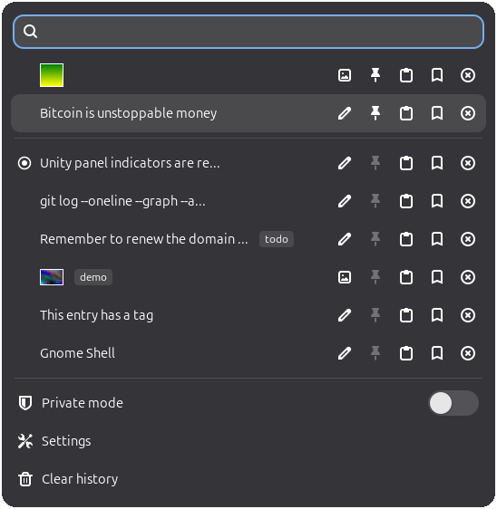
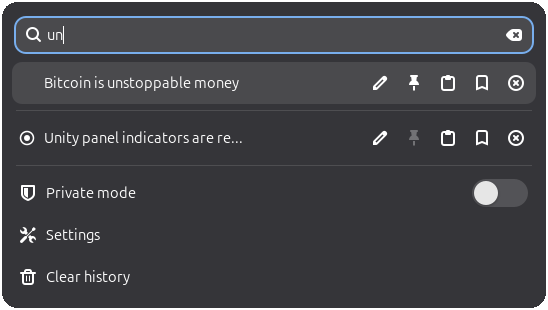
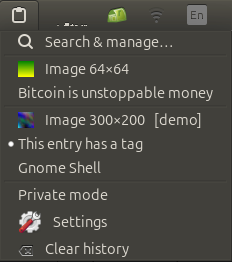
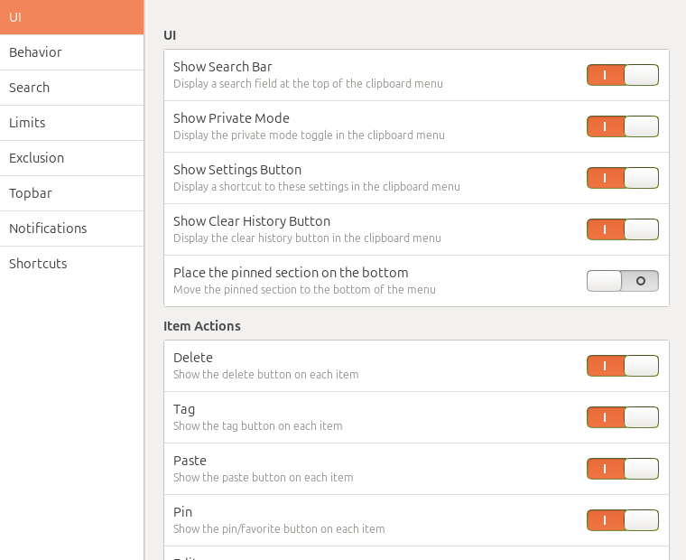

# 📋 Unity Clipboard Indicator

A fast, lightweight clipboard history manager for the **Ubuntu Unity** desktop, written in modern **C++23**. It brings the look, feel and feature set of the popular GNOME Shell *Clipboard Indicator* extension to Unity 7, with a strong focus on a ⚡ **tiny memory and CPU footprint**.

<p align="center"></p>

## 💡 Inspiration

This project is a from-scratch rewrite inspired by [**Clipboard Indicator** for GNOME Shell](https://github.com/Tudmotu/gnome-shell-extension-clipboard-indicator) by Yotam Bar-On (Tudmotu) and its contributors. GNOME Shell extensions are JavaScript that runs inside the GNOME Shell process, so they cannot run under Unity. This project reproduces the extension's popup design, keyboard controls, settings and registry file format as a standalone native application. ❤️ All credit for the original design and feature set goes to the original authors.

## ✨ Features

- 🖼️ **Image support**: copy and paste images as well as text; thumbnails appear in both menus.
- 📌 **Pin items**: keep important entries in their own section at the top (or bottom) of the menu.
- 🔍 **Search**: filter entries as you type, by plain text or regular expression, case sensitive or not; tags are searched too.
- ✏️ **Edit entries**: change the text of a stored entry; if it is the current clipboard content, the clipboard updates as well.
- 🏷️ **Tag entries**: attach a short label to any entry to organise and find it.
- ⌨️ **Global shortcuts**: open the menu, step to the previous or next entry, clear history and toggle private mode without touching the mouse.
- 📥 **Paste from the menu**: entries are pasted straight into the window you were working in (Shift+Insert, or Ctrl+Shift+Insert in terminals).
- 🕵️ **Private mode**: pause history recording while you handle sensitive data.
- 🚫 **Exclude apps**: nothing is recorded while chosen applications (for example a password manager) are focused.
- 🔐 **Password manager aware**: clipboard contents marked as secret (`x-kde-passwordManagerHint`, used by KeePassXC and others) are never recorded.
- 🧹 **Auto-clear**: clear the history on a recurring interval (with a live countdown) or at every system boot.
- 🛟 **Clipboard persistence**: when the application you copied from exits, its content stays available for pasting.
- 🖱️ **Panel extras**: middle-click the panel icon to open the full popup; scroll over it to step through the history.
- 🔔 **Notifications**: optional desktop notifications on copy, on cycling through entries and on clear.
- 🧩 **Highly configurable**: every option of the original extension that makes sense on Unity is available in the settings window.

## 🖼️ Screenshots

| Full popup with search | Native Unity panel menu |
|:---:|:---:|
|  |  |

<p align="center"></p>

## 🏗️ How it works

Unity's panel can only render plain menus sent over D-Bus: labels, icons, check marks and radio dots. There is no room for a search field or per-row buttons inside the panel dropdown. The application is therefore split into two small programs, so you get both a native panel menu and the extension's rich popup.

**`clipboard-indicatord`**, the resident daemon:

- ⚙️ Built on GLib/GIO, Xlib and gdk-pixbuf only, with **no GTK** loaded into the always-running process.
- 👂 Watches the clipboard through XFixes selection events, so it is **event driven and uses no CPU while idle**; there is no polling.
- 📤 Reads and serves clipboard contents itself, including the INCR protocol for large transfers.
- 🧭 Speaks Unity's indicator protocols directly (`org.kde.StatusNotifierItem` with the Ayatana label extensions, plus a `com.canonical.dbusmenu` server), avoiding libappindicator and the GTK dependency it would bring.
- 💾 Keeps text entries in memory and stores images only as files on disk; the history is saved with a debounce, atomically, with `0600` permissions.
- ⌨️ Grabs the global hotkeys and fakes the paste keystroke through XTest.

**`clipboard-indicator-ui`**, the on-demand GTK3 front end:

- 🪟 Shows the popup and the settings window, styled after the GNOME Shell menu, with Adwaita symbolic icons regardless of your icon theme.
- 🎯 The popup is an override-redirect window that holds a pointer and keyboard grab like a real menu, so the application you were typing in **keeps its focus** and receives the paste.
- 💤 It **starts only when needed and exits when closed**, so it uses no memory at all while hidden. A second invocation is forwarded to the running instance, which is how the hotkey toggles the popup.

## 📊 Footprint

Measured on Ubuntu 26.04 with Unity 7.7 and a populated history:

| Process | Private memory (RssAnon) | Total RSS incl. shared libraries | When it runs |
|---|---|---|---|
| `clipboard-indicatord` | ≈ 2.3 MB | ≈ 17 MB | always |
| `clipboard-indicator-ui` | ≈ 10 MB | ≈ 50 MB | only while a window is open |

Most of the daemon's RSS is shared library code that other processes already have loaded. The binaries are built without exceptions or RTTI, with link-time optimisation, dead-code elimination and `--as-needed` linking.

## 📦 Requirements

- 🐧 Ubuntu with the **Unity 7** desktop running on **X11** (Unity does not support Wayland). Other desktops with a StatusNotifierItem/Ayatana indicator host may work but are untested.
- 🛠️ A C++23 compiler (GCC 13 or newer), CMake 3.25 or newer and pkg-config.
- 📚 Development packages for GLib/GIO, gdk-pixbuf, X11, XFixes, XTest and GTK 3.

```bash
sudo apt install build-essential cmake pkg-config \
    libglib2.0-dev libgdk-pixbuf-2.0-dev libx11-dev libxfixes-dev libxtst-dev libgtk-3-dev
```

## 🔨 Build and install

```bash
cmake -S . -B build -DCMAKE_BUILD_TYPE=Release
cmake --build build -j"$(nproc)"
sudo cmake --install build      # installs to /usr/local by default
```

The install step puts both binaries in `bin/`, the panel icons in `share/clipboard-indicator/icons` and `share/icons/hicolor`, and a launcher for the settings window in `share/applications`. 🔁 The autostart entry goes into `~/.config/autostart/clipboard-indicator.desktop` of the user who runs the install: under `sudo` that is the invoking user (taken from `SUDO_USER`), not root, and the file plus any directories it creates are owned by that user. Then start the daemon, or log out and back in:

```bash
clipboard-indicatord &
```

👤 **Per-user install without root**: configure with `-DCMAKE_INSTALL_PREFIX="$HOME/.local"` and run `cmake --install build`; the autostart entry lands in your own `~/.config/autostart` as well.

🏢 **System-wide autostart**: configure with `-DCI_AUTOSTART_SYSTEM=ON` to install the entry into `<sysconfdir>/xdg/autostart` for all users instead (use `-DCMAKE_INSTALL_PREFIX=/usr -DCMAKE_INSTALL_SYSCONFDIR=/etc` so the session finds it). 📦 When `DESTDIR` is set, as in distribution packaging, the system-wide location is always used and no home directory is touched.

🧪 **Trying it without installing**: the daemon looks for its icons and for `clipboard-indicator-ui` next to its own executable, so `./build/clipboard-indicatord` works straight from the build directory.

## 🚀 Usage

Click the 📋 icon in the Unity panel to get the native menu: pick an entry to put it on the clipboard, toggle private mode, open the settings or clear the history. Choose **Search & manage…**, middle-click the icon or press **Ctrl+F9** to open the full popup with search and per-entry actions.

### ⌨️ Global shortcuts (defaults)

| Shortcut | Action |
|---|---|
| `Ctrl+F9` | Toggle the popup |
| `Ctrl+F10` | Clear history |
| `Ctrl+F11` | Previous entry |
| `Ctrl+F12` | Next entry |
| `Ctrl+F8` | Toggle private mode |

All shortcuts can be changed or disabled in **Settings → Shortcuts**: click a shortcut, then press the new key combination, or press Backspace to disable it.

### 🎹 In-popup keyboard controls

| Key | Action |
|---|---|
| `↑` `↓` | Move between the search field and the entries |
| `Enter` | Select the entry (and paste it if *Paste on select* is on) |
| `Delete` | Delete the entry |
| `v` | Paste the entry directly |
| `p` | Pin or unpin the entry |
| `t` | Add or edit a tag |
| `e` | Edit a text entry |
| `h` | Preview an image entry |
| `Esc` | Close the popup, or leave the edit, tag or confirmation page |
| *any other text* | Jumps to the search field |

In the edit page, `Ctrl+Enter` saves; in the tag page, `Enter` saves.

### 🖥️ Terminal support

Pasting from the menu sends **Shift+Insert** to normal applications and **Ctrl+Shift+Insert** to terminals, which are recognised by their window class (GNOME Terminal, Konsole, Tilix, Terminator, Alacritty, kitty, Ghostty, WezTerm, xterm and similar). For tmux, add a binding for `C-S-IC` as described in the original extension's README; for Ghostty, add `keybind = ctrl+shift+insert=paste_from_clipboard` to its configuration.

## ⚙️ Configuration

Settings are edited in the settings window (**Settings** in either menu, or the *Clipboard Indicator Settings* launcher) and stored as a plain key file. ♻️ The daemon notices changes immediately through inotify, so there is nothing to restart.

| Path | Contents |
|---|---|
| `~/.config/clipboard-indicator/settings.ini` | All settings, human readable and hand-editable |
| `~/.cache/clipboard-indicator/registry.txt` | The history as JSON, in the same format as the GNOME extension |
| `~/.cache/clipboard-indicator/<hash>` | Cached images |

The settings are grouped exactly as in the original: **UI** (which elements and item buttons to show, pinned section position), **Behavior** (paste on select, open at cursor, move to top, strip whitespace, confirmations, image caching, auto-clear), **Search** (case sensitivity, regular expressions), **Limits** (history size, preview length, cache file size), **Exclusion** (excluded applications by `WM_CLASS`; run `xprop WM_CLASS` and click a window to find it), **Topbar** (icon, content, both or nothing in the panel; preview length; blink on copy) and **Notifications**.

## 🔄 Differences from the GNOME extension

- 🧱 The panel dropdown is a native Unity menu; the full popup opens from the panel menu, a middle-click or the shortcut.
- 🗂️ Settings live in an INI file instead of GSettings, and excluded applications are entered as window class names, one per line.
- 🚀 The menu shortcut toggles a separate popup window, placed under the panel at the top right of the screen (or at the mouse pointer with *Open menu at cursor*).
- 🚫 The *Remove down arrow* option does not apply, because Unity's panel has no dropdown arrows.
- ➕ New: clipboard persistence after the source application exits, password-manager hints, middle-click to open and scroll to cycle.
- 🌐 The interface is currently English only.

## 🧯 Troubleshooting

- ❓ **No icon in the panel**: make sure `clipboard-indicatord` is running and the session is Unity on X11. Only one instance runs at a time; a second one exits with "already running".
- ⌨️ **A shortcut does nothing**: another program may have grabbed that key combination; the daemon logs `could not bind shortcut …` to stderr. Pick a different combination in the settings.
- 📋 **Paste from the menu does not work in some application**: that application may not accept Shift+Insert; select the entry and paste with the application's own shortcut instead.
- 🗑️ **Starting over**: stop the daemon and delete `~/.cache/clipboard-indicator`.

## 🗺️ Project layout

```
src/common/   settings (INI) and UTF-8 helpers shared by both programs
src/daemon/   clipboard-indicatord: X11 clipboard, indicator + dbusmenu, history, D-Bus API
src/ui/       clipboard-indicator-ui: popup, settings window, styling
data/         panel icons and desktop entries
```

The UI talks to the daemon over the session bus (`io.github.UnityClipboardIndicator`), using methods such as `GetHistory`, `Activate`, `Paste`, `TogglePin`, `Delete`, `SetTag`, `SetText`, `ClearHistory`, `SetPrivate` and `ResetTimer`, plus a `Changed` signal.

## 📜 Credits and license

💐 Inspired by [gnome-shell-extension-clipboard-indicator](https://github.com/Tudmotu/gnome-shell-extension-clipboard-indicator) © 2014 Yotam Bar-On and contributors, released under the MIT License. The panel icon is derived from the Adwaita icon theme by the GNOME Project (CC BY-SA 3.0 / LGPL 3), and the popup uses Adwaita symbolic icons installed on the system.
